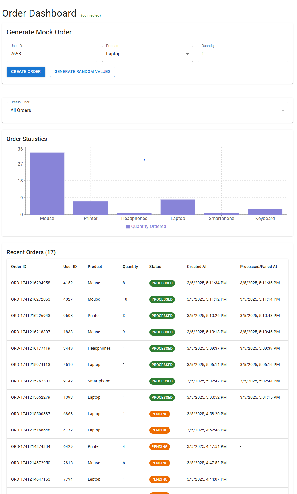
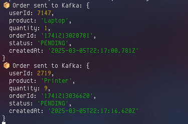

# Real-time Order Processing System (Kafka, Redis, MongoDB)

An event-driven order processing system built from small Node.js services. Orders are created through a REST API, processed asynchronously via Kafka, cached and broadcast with Redis, stored in MongoDB, and shown live on a React dashboard over WebSockets.

## Screenshots


*Dashboard with status filtering, live updates and order statistics*


*API Gateway structured logging (Winston)*

## Architecture

| Service | Role |
|---|---|
| **api-gateway** (Express, Socket.IO) | REST API, saves orders to MongoDB, publishes `order-created` to Kafka (via an outbox), serves cached reads, pushes live events to the dashboard |
| **order-service** (Kafka consumer) | Consumes `order-created`, processes the order, updates MongoDB, publishes `order-processed` / `order-failed` |
| **notification-service** (Kafka consumer) | Consumes all order topics and republishes them on a Redis pub/sub channel (`order-updates`) |
| **frontend** (React, Material-UI) | Live dashboard with status filter and charts |
| **Kafka** | Event backbone (3 topics, 3 partitions each, keyed by order ID) |
| **Redis** | Pub/sub bridge from Kafka to WebSockets + cache-aside for order reads |
| **MongoDB** | Order persistence |

## How it works

1. `POST /api/orders` saves the order as `PENDING` (with `eventPublished: false`), publishes `order-created` to Kafka, marks `eventPublished: true`, and emits `orderCreated` to connected clients.
2. The order service consumes the event, processes the order (simulated work), sets the status to `PROCESSED` or `FAILED`, and publishes the result to Kafka.
3. The notification service forwards every Kafka event to the Redis channel `order-updates`.
4. The gateway subscribes to that channel, clears the cached order lists, and pushes the event to the dashboard over Socket.IO.
5. `GET /api/orders?status=...` uses **cache-aside**: Redis first (10 s TTL, one key per status), MongoDB on a miss.

## Reliability design

### 1. Outbox pattern: never lose an order event
**Problem:** saving to MongoDB and publishing to Kafka are two different systems. If Kafka is down right after the save, the order exists but nobody is ever told to process it.

**Solution:** the order document has an `eventPublished` flag. It is saved together with the order in a single MongoDB write (one document write is atomic, so no multi-document transaction is needed). The gateway then publishes to Kafka and flips the flag to `true` only after Kafka accepts the message. A background **relay** runs every few seconds and publishes any order whose flag is still `false`.

- Kafka down: the API still returns `201`, the order waits with `eventPublished: false`, and the relay publishes it when Kafka is back.
- The relay skips orders younger than a few seconds so it does not race with the normal request path.
- It can occasionally publish the same event twice (for example, a crash after Kafka accepted it but before the flag was updated). That is acceptable because consumers are idempotent (next section).

### 2. Idempotent processing: a duplicate message does no harm
Kafka guarantees **at-least-once** delivery, so the same message can arrive twice (rebalance, retry, outbox re-send).

The order service only allows `PENDING -> PROCESSED/FAILED` **once**. It uses a conditional update, `findOneAndUpdate({ orderId, status: 'PENDING' }, ...)`, which MongoDB applies atomically. If the update matches nothing, someone already finished the order, so no second result event is published. There is also an early check to skip obvious duplicates and avoid wasted work.

### 3. Redis is an optimisation, never a dependency
Reads try Redis first; if Redis is down, the error is caught and treated as a cache miss, so the API answers from MongoDB. The cache client uses `disableOfflineQueue`, so commands fail immediately instead of hanging until Redis returns. Writes and cache invalidation are best-effort. A short TTL (10 s) limits how stale data can get if an invalidation is missed.

## Quick start (Docker)

Requires Docker and Docker Compose.

```bash
docker compose up --build
```

Then open **http://localhost:3000**. Click "Generate Random Values" and "Create Order", and watch orders move from PENDING to PROCESSED (or FAILED).

The API is on http://localhost:4000 (`GET /health`, `GET /api/orders`, `POST /api/orders`).

Stop with `docker compose down` (add `-v` to also delete the MongoDB data).

### Try the failure scenarios

```bash
docker compose stop kafka          # create an order: still returns 201, stays PENDING
docker compose start kafka         # within ~10 s the outbox relay publishes it and it gets processed

docker compose stop redis          # GET /api/orders still works (served from MongoDB)
docker compose stop order-service  # orders stay PENDING until it starts again
```

## Run locally without Docker for the apps

```bash
docker compose up -d mongodb redis zookeeper kafka kafka-init   # infrastructure only

cd backend/api-gateway && npm install && npm run dev            # port 4000
cd backend/order-service && npm install && npm run dev          # port 3005
cd backend/notification-service && npm install && npm run dev   # port 3002
cd frontend && npm install && npm start                         # port 3000
```

## Configuration

| Variable | Used by | Default |
|---|---|---|
| `KAFKA_BROKER` | all backend services | `localhost:9092` |
| `MONGODB_URI` | gateway, order-service | `mongodb://localhost:27017/order-management` |
| `REDIS_URL` | gateway, notification-service | `redis://localhost:6379` |
| `CORS_ORIGIN` | gateway | any origin (set it in production) |
| `OUTBOX_INTERVAL_MS` | gateway | `5000` (how often the relay runs) |
| `OUTBOX_GRACE_MS` | gateway | `5000` (relay ignores orders newer than this) |
| `PROCESSING_DELAY_MS` | order-service | `2000` |
| `FAILURE_RATE` | order-service | `0.1` (10% of orders fail so the FAILED path is visible in demos) |
| `REACT_APP_API_URL` | frontend (build time) | `http://localhost:4000` |

## Known limitations & future work

- Processing is simulated (a timed delay with a configurable failure rate), not real business logic.
- The outbox is a simple flag plus polling relay; a production system might use change streams or a dedicated outbox collection.
- If the order service updates MongoDB but then fails to publish its result event, the dashboard may miss the live update until the next refresh (the same idea could be applied there).
- No retry with backoff or dead-letter topic for failed messages yet.
- No request validation library (Joi/Zod); order IDs are timestamp-based, so UUIDs would avoid collisions under heavy load.
- No automated tests or CI pipeline yet.
- Single-broker Kafka without auth; a production setup needs a replicated cluster and SASL/SSL.

## Tech stack

Node.js, Express, Socket.IO, KafkaJS, Redis, MongoDB (Mongoose), React, Material-UI, Recharts, Docker Compose.

## License

MIT
